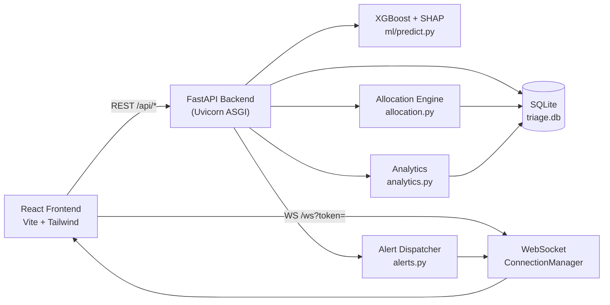

# 🏥 Hospital Triage System

> An intelligent, real-time emergency department triage platform — ML-powered urgency scoring, automatic resource allocation, live WebSocket dashboard, and role-based access control.

**This is a decision-support prototype built for educational and demonstration purposes. It is NOT a certified medical device. Clinicians make all final triage decisions.**

---

## Features

| Feature | Detail |
|---------|--------|
| 📋 Digital patient intake | Web form for name, age, gender, vitals, and symptoms |
| 🤖 ML triage classifier | XGBoost, 95.75 % accuracy, Level 1–5 (ESI-style) |
| 🏷️ Explainable reason tags | SHAP values → human-readable tags on every patient card |
| 🛏️ Automatic resource matching | ICU / Emergency / General bed + doctor assignment in < 1 s |
| 📡 Live dashboard | WebSocket push: queue, beds, doctors, all synced in real time |
| 🚨 Instant alerts | Level-1 admission and escalation alerts dispatched to doctors |
| 🔄 Live re-prioritisation | Vitals update re-runs the ML model; queue re-sorts automatically |
| 🔐 Role-based access | NURSE · DOCTOR · ADMIN permission matrix enforced at every endpoint |
| 📜 Audit log | Every state change recorded; global log for ADMIN/DOCTOR |
| 📊 Admin panel | Manage beds, doctors, shifts, users; activity log |
| 📈 Analytics | Triage distribution, occupancy, wait times by level, timeline charts |

---

## Architecture



---

## Tech Stack

| Layer | Technology |
|-------|-----------|
| Frontend | Vite 6, React 18, Tailwind CSS v4, recharts, lucide-react, react-router-dom |
| Backend | FastAPI 0.165, SQLAlchemy 2, Uvicorn, Python 3.11+ |
| Auth | PyJWT (HS256), bcrypt, OAuth2PasswordBearer |
| ML | XGBoost 3.4, scikit-learn 1.6, SHAP 0.54 |
| Database | SQLite (dev) – swap to PostgreSQL for production |
| Testing | pytest (backend), Vitest (frontend), httpx (E2E smoke test) |

---

## Quick Start

### Prerequisites
- Python 3.11+
- Node.js 18+

### macOS / Linux
```bash
git clone <repo-url>
cd hospital-triage
chmod +x scripts/start.sh
./scripts/start.sh
```

### Windows
```bat
scripts\start.bat
```

The startup script will:
1. Create `backend/.venv` and install Python dependencies
2. Run `npm install` in `frontend/` if needed
3. Seed `triage.db` if it doesn't exist
4. Start the FastAPI backend on port 8000 and Vite on port 5173

### Manual startup
```bash
# Terminal 1 – backend
cd backend
python -m venv .venv && .venv/bin/pip install -r requirements.txt
.venv/bin/python seed.py          # first time only
.venv/bin/uvicorn main:app --reload

# Terminal 2 – frontend
cd frontend
npm install
npm run dev
```

**Open:** http://localhost:5173

---

## Demo Accounts

All accounts use password `demo123`.

| Username | Role | Access |
|----------|------|--------|
| `admin` | ADMIN | Full access: all endpoints, analytics, admin panel |
| `nurse1` | NURSE | Patient intake, queue, discharge, alerts |
| `nurse2` | NURSE | Same as nurse1 |
| `dr1` – `dr5` | DOCTOR | Dashboard, own alerts, vitals update, discharge |

---

## Run Tests

```bash
# Backend pytest suite
cd backend && .venv/bin/pytest tests/ -v

# Frontend unit tests (109 tests)
cd frontend && npm test

# Frontend production build
cd frontend && npm run build

# E2E smoke test (requires running server)
cd backend && .venv/bin/python ../tests_e2e/smoke_test.py

# Or use Make:
make test            # backend + frontend
make test-smoke      # E2E smoke test
```

---

## Run the Demo

See **[docs/DEMO_SCRIPT.md](docs/DEMO_SCRIPT.md)** for the full 5-minute scripted demo.

Quick version:
```bash
cd backend
python demo.py reset             # Rebuild DB, seed users + beds
python demo.py scenario          # Run scripted patient story (narrated)
python demo.py scenario --speed fast   # Same, but faster
```

---

## Screenshots

> Place screenshots in `docs/screenshots/` after running the demo. See [docs/screenshots/README.md](docs/screenshots/README.md) for the full list.


---

## Project Structure

```
hospital-triage/
├── backend/                  FastAPI application
│   ├── main.py               API routes, WebSocket endpoint, lifespan
│   ├── models.py             SQLAlchemy ORM models
│   ├── schemas.py            Pydantic request/response schemas
│   ├── auth.py               JWT auth, bcrypt, RBAC dependencies
│   ├── triage_service.py     ML prediction wrapper
│   ├── allocation.py         Bed + doctor assignment engine
│   ├── alerts.py             Alert generation and dispatch
│   ├── realtime.py           WebSocket ConnectionManager + publish()
│   ├── analytics.py          Analytics API router
│   ├── admin_routes.py       Admin CRUD API router
│   ├── database.py           SQLAlchemy engine + session
│   ├── seed.py               Initial beds, doctors, users, shifts
│   ├── demo.py               Demo tooling (reset + scenario)
│   ├── simulate.py           Random patient load simulator
│   ├── requirements.txt      Python dependencies (pinned)
│   ├── .env.example          Environment variable reference
│   └── tests/                pytest test suite
│
├── frontend/                 React SPA
│   ├── src/
│   │   ├── pages/            Login, Intake, Dashboard, Analytics,
│   │   │                     History, Alerts, Admin, PatientDetail
│   │   ├── components/       Layout, AlertToasts, dashboard/, admin/, ui/
│   │   ├── context/          AuthContext, LiveContext (WebSocket)
│   │   ├── hooks/            useLiveSocket, useDashboardData
│   │   └── lib/              api.js, urgency.jsx, validation.js,
│   │                         analyticsLogic.js, shiftLogic.js
│   └── README.md             Frontend-specific docs
│
├── ml/                       ML training pipeline
│   ├── predict.py            Inference + SHAP explanations
│   ├── model/                model.json, features.json, metrics.json
│   └── notebooks/            Training notebook
│
├── tests_e2e/
│   └── smoke_test.py         End-to-end smoke test (requires live server)
│
├── docs/
│   ├── MODEL_CARD.md         ML model documentation
│   ├── DEMO_SCRIPT.md        5-minute demo script
│   ├── PRESENTATION_OUTLINE.md  10-slide presentation outline
│   └── screenshots/          Screenshot folder (add after demo)
│
├── scripts/
│   ├── start.sh              One-command startup (macOS/Linux)
│   └── start.bat             One-command startup (Windows)
│
├── Makefile                  make start / test / reset-demo / scenario
└── README.md                 This file
```

---

## API Overview

Full API documentation: **[backend/README.md](backend/README.md)** or visit http://127.0.0.1:8000/docs when the server is running.

Key endpoints:

| Method | Path | Auth | Description |
|--------|------|------|-------------|
| GET | `/health` | Public | Health check (`status`, `db`, `model_loaded`) |
| POST | `/auth/login` | Public | OAuth2 form login → JWT |
| POST | `/patients` | NURSE, ADMIN | Intake patient, run ML triage |
| GET | `/queue` | All | Waiting patients, priority-sorted |
| PUT | `/patients/{id}/vitals` | All | Update vitals, re-run triage |
| PUT | `/patients/{id}/discharge` | All | Discharge, free bed + doctor |
| GET | `/alerts` | All* | Clinical alerts (*DOCTOR scoped to own) |
| WS | `/ws?token=` | All | Live event stream |
| GET | `/analytics/summary` | All | KPI summary |
| GET | `/admin/beds` | ADMIN | Manage beds |

---

## Limitations & Future Work

**Current limitations:**
- Trained on synthetic data only – not validated with real clinical data
- Simple keyword matching for symptom features
- SQLite not suitable for concurrent production load
- No real EHR integration

**Future work:**
- Real EHR integration (HL7 FHIR)
- Real patient data with IRB approval and clinical validation
- PostgreSQL + Docker Compose for production deployment
- SMS/pager alerts via Twilio
- Audit log CSV/PDF export for regulatory compliance
- Offline support and mobile-responsive layout improvements

---

## Medical Disclaimer

This system is a **software engineering prototype** built for educational and demonstration purposes.

- It is **NOT** a certified medical device.
- It has **NOT** been validated with real patient data.
- It is **NOT** intended for use in a real emergency department.
- **Clinicians always make the final triage decision.**

For real triage software, refer to certified clinical decision-support systems (e.g., Cerner FirstNet, Epic).
